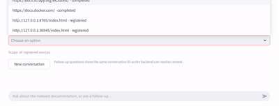
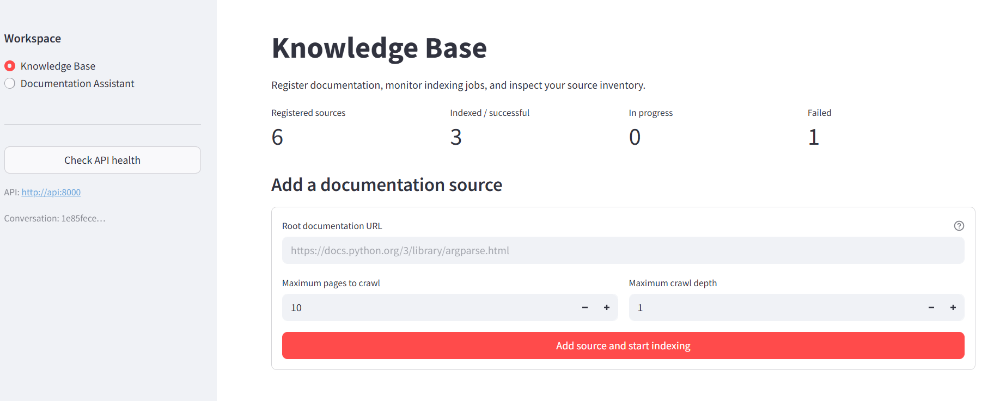
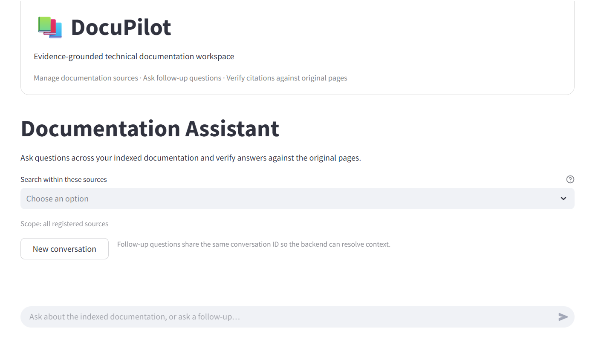
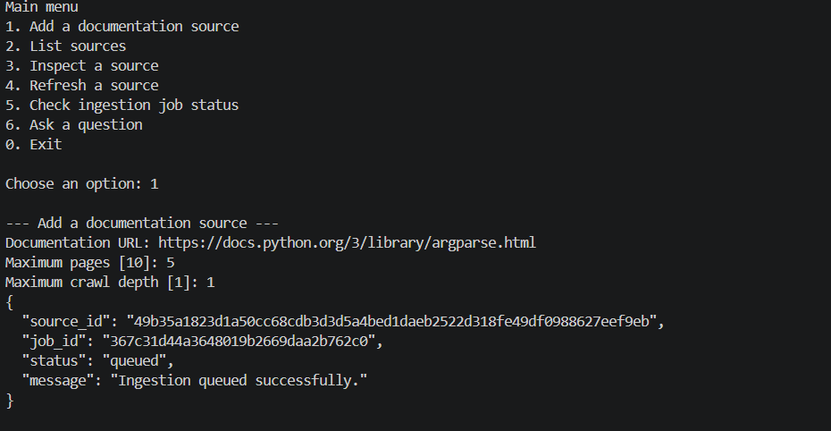
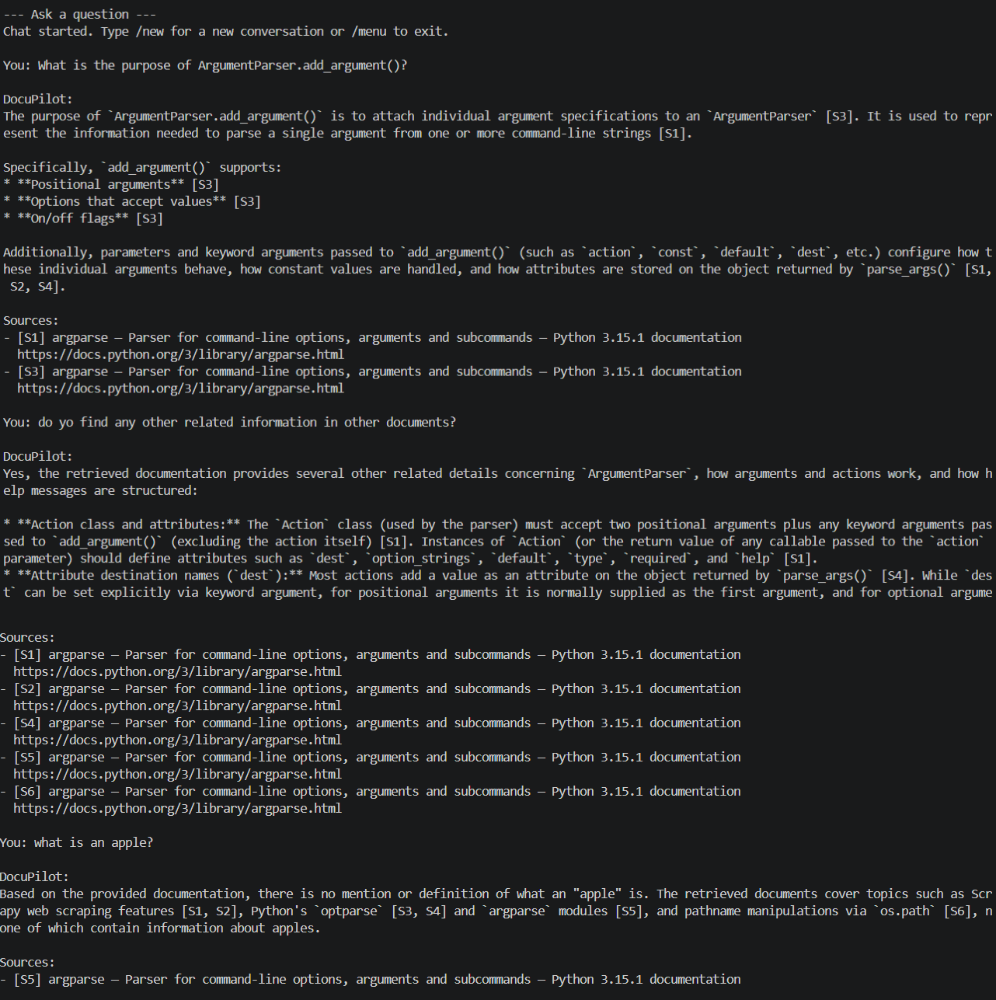
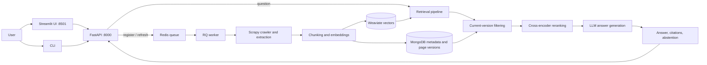

# DocuPilot

**An evidence-grounded technical documentation assistant.**

DocuPilot crawls selected documentation URLs, extracts and indexes their content, retrieves relevant passages for a question, and generates answers with page-level citations. When the retrieved evidence is insufficient, the system can abstain rather than present an unsupported answer.

The project is designed as a reproducible, Docker Compose-based RAG application with a FastAPI backend, background ingestion, persistent metadata and vector search, a CLI, and an optional Streamlit workspace.

## What it does

- Register a documentation URL and configure crawl limits.
- Ingest documentation asynchronously through a Redis Queue (RQ) worker.
- Store source, page, crawl, conversation, and version metadata in MongoDB.
- Create embeddings and store searchable vectors in Weaviate.
- Retrieve candidate passages, apply cross-encoder reranking, and generate an answer from the selected evidence.
- Return page-level citations and abstain when the evidence does not support a reliable answer.
- Continue a conversation using a conversation ID.
- Use the same API through either the interactive Streamlit UI or the CLI.

## Demo

The UI has two workspaces:

- **Knowledge Base** — register source URLs, check ingestion jobs, inspect page/version counts and crawl summaries, and refresh a source.
- **Documentation Assistant** — ask questions across indexed sources, ask follow-ups, and inspect citation URLs and chunk metadata.

### Frontend demo

<!-- TODO: Add docs/assets/docupilot-demo.gif after capturing the real application. -->
<!--  -->

**GIF placeholder:** `docs/assets/docupilot-demo.gif`

<!-- TODO: Add docs/assets/docupilot-demo.mp4 after recording the real application. -->
**Video placeholder:** [docs/assets/docupilot-demo.mp4](docs/assets/docupilot-demo.mp4)

### Screenshots and CLI output

Capture screenshots from a real run and save them at the paths below. These image references are intentionally commented out until the files are added.

- `docs/assets/screenshots/knowledge-base.png` — source list and indexing status.
- `docs/assets/screenshots/documentation-assistant.png` — question, answer, and citation panel.
- `docs/assets/screenshots/cli-ingestion.png` — CLI source registration or job status.
- `docs/assets/screenshots/cli-answer.png` — CLI answer and citation URLs.

<!--  -->
<!--  -->
<!--  -->
<!--  -->

Do not use fabricated results or include API keys, private documentation, or other sensitive data in screenshots or recordings.

## Architecture at a glance



The API handles source management and question requests. Ingestion runs asynchronously so crawling does not block the registration request. MongoDB stores source/page/crawl/version/conversation metadata; Weaviate stores vectors for semantic retrieval. The question path retrieves candidates, filters stale page versions, reranks evidence, and asks the configured LLM to answer from that evidence. The API returns the answer, citation metadata, timings, and abstention state.

For component responsibilities, data flow, API endpoints, and design decisions, see **[Architecture and design decisions](docs/architecture.md)**.

## Requirements

- Docker Engine and the Docker Compose plugin.
- An LLM provider API key supported by the configured OpenAI-compatible client.
- Git, if cloning the repository.
- Internet access during initial image/package downloads and when crawling public documentation or calling the LLM provider.

Python 3.11 is used in the project Docker images. The UI is optional and runs in a separate container.

## Quick start with Docker Compose

Run commands from the repository root.

### 1. Get the code and configure the environment

```bash
git clone https://github.com/PBhat07/docupilot.git
cd docupilot
cp .env.example .env
```

Edit `.env` and set the LLM provider values for your environment:

```dotenv
LLM_API_KEY=your_api_key
LLM_BASE_URL=https://generativelanguage.googleapis.com/v1beta/openai/
LLM_MODEL=your_supported_model_name
LLM_TIMEOUT_SECONDS=60
```

The values above illustrate the variables used by the current example configuration. Use a model name supported by your provider and the project's client. Keep `.env` private; never commit real credentials.

### 2. Build and start the backend

```bash
docker compose up --build -d
docker compose ps
```

The default Compose stack starts the API, RQ worker, Redis, MongoDB, and Weaviate.

Check API health and open the interactive API documentation:

- Health: [http://localhost:8000/health](http://localhost:8000/health)
- OpenAPI / Swagger UI: [http://localhost:8000/docs](http://localhost:8000/docs)

The health endpoint confirms that the API responds. For question answering to work, the API must also initialize its backing services and LLM configuration successfully; check logs if startup fails.

### 3. Start the optional Streamlit UI

In the same repository, run:

```bash
docker compose --profile ui up --build -d ui
```

Open [http://localhost:8501](http://localhost:8501).

If the UI image build times out while downloading Python packages, retry the build when the connection is stable. The API and UI are separate services; a UI build failure does not by itself mean the backend image failed.

### 4. Use DocuPilot

1. Open **Knowledge Base**.
2. Enter a public documentation URL and choose the maximum pages and crawl depth. Start with a small limit while testing.
3. Wait for the ingestion job to finish. Use the source/job status and logs to investigate failures.
4. Open **Documentation Assistant** and ask a question that can be answered from the indexed documentation.
5. Expand the citations to open the original documentation page and inspect the returned source/chunk metadata.
6. Ask a follow-up in the same conversation, or select **New conversation** to reset the UI conversation.

The current API provides indexed-page counts and crawl summaries for a source, not a complete inventory endpoint listing every indexed page URL. Page-level URLs are shown for pages cited in individual answers.

### CLI

The CLI is available in the API container and uses the same HTTP API:

```bash
docker compose exec api python -m docupilot.cli
```

Use the menu to register a source, list or inspect sources, refresh a source, check an ingestion job, or ask questions. The CLI prints JSON for source/job operations and displays answer citations and related documentation links.

### Logs, stop, and reset

```bash
# Follow backend and worker logs
docker compose logs -f api worker

# Follow UI logs
docker compose logs -f ui

# Stop only the optional UI
docker compose --profile ui stop ui

# Stop and remove containers and the Compose network
docker compose --profile ui down
```

Named volumes persist MongoDB, Weaviate, and Redis data. **Avoid `docker compose down -v` unless you intentionally want to delete persisted data.**

## Development and tests

The project uses a Python 3.11 environment in Docker. To run the existing tests in the API container:

```bash
docker compose exec api pytest -q
```

For a clean local environment, create a Python 3.11 virtual environment and install the project with development dependencies:

```bash
python -m venv .venv
# Linux/macOS
source .venv/bin/activate
# Windows PowerShell: .venv\Scripts\Activate.ps1
python -m pip install --upgrade pip
python -m pip install -e ".[dev]"
pytest -q
```

The full application requires the configured backing services and environment variables. For the most reproducible end-to-end setup, use Docker Compose.

### Suggested contribution workflow

1. Open an issue or describe the change you intend to make.
2. Create a focused branch from the current development baseline.
3. Keep changes small and include or update tests where practical.
4. Run `pytest -q` and manually smoke-test the affected API/UI path.
5. Update documentation when changing API contracts, configuration, data flow, or user-facing behavior.
6. Open a pull request with the purpose, design choice, test commands/results, and known limitations.

Example:

```bash
git switch dev
git pull --ff-only origin dev
git switch -c feature/describe-your-change
# make changes
pytest -q
git add <changed-files>
git commit -m "Describe the change"
git push -u origin feature/describe-your-change
```

Do not commit `.env`, tokens, crawled private content, local databases, generated model files, or large unreviewed outputs.

## Evaluation

The repository includes an exploratory comparison of retrieval/reranking configurations. The current small run has incomplete paired results: some questions failed during generation because of provider quota/rate limits. A few successful examples show changes in context precision, faithfulness, and latency, but this is **not sufficient evidence of an overall quality improvement**.

Before making a general performance claim, rerun a larger, fixed question set with stable provider availability, compare the same questions across configurations, inspect citations and retrieved chunks, and report both quality and latency. See the evaluation assets and scripts in the repository for the current implementation.

## Limitations

- The current evaluation set is small and some runs are incomplete; results are exploratory rather than statistically conclusive.
- LLM provider rate limits, quotas, authentication, and outages can cause generation requests to fail.
- Crawl coverage depends on the target site's structure, link discoverability, crawl depth/page limits, and whether useful content is available to the crawler.
- The current source detail API returns page counts and crawl summaries but does not list every indexed page URL.
- Citation metadata points to the original page and chunk identifiers; the current API/UI does not display the full retrieved evidence excerpt as a citation quote.
- Answer quality depends on extraction quality, retrieval relevance, the selected model, and the quality of the indexed source.
- The current Compose configuration is a local development/demo setup, not a hardened multi-user production deployment. Authentication, authorization, tenant isolation, and production operational controls are not implemented here.
- Semantic vector retrieval and cross-encoder reranking add model initialization, CPU, memory, and latency costs.

## Future work

- Expand the evaluation dataset and add repeatable paired comparisons for retrieval quality, faithfulness, citation correctness, abstention, and end-to-end latency.
- Label relevant chunks and report retrieval metrics such as MRR and nDCG alongside answer-level review.
- Evaluate reranking on/off trade-offs and tune candidate/final result counts using measured results.
- Add an API endpoint and UI view for the full indexed-page inventory and, where practical, retrieved evidence excerpts.
- Improve ingestion observability, retries, job failure diagnostics, and handling of dynamic or difficult-to-extract sites.
- Add authentication, per-user source isolation, and production deployment/security controls before exposing the service beyond a trusted local environment.
- Add CI checks and a repeatable integration-test setup for the full Compose stack.

## Reproducibility

When reporting a result, record the Git commit SHA, environment/provider configuration (without secrets), model name, evaluation dataset version, retrieval/reranking settings, and test command. Keep the question set and configuration fixed when comparing runs. Separate successful model generations from failures caused by provider availability or quota so that incomplete runs are not treated as quality measurements.

## Project structure

```text
.
├── src/docupilot/       # FastAPI API, crawler, ingestion jobs, indexing, retrieval, generation
├── ui/app.py            # Optional Streamlit workspace
├── tests/               # Unit and API tests
├── scripts/             # Inspection and diagnostic scripts
├── evaluation/          # Evaluation code/data when present in the checked-out branch
├── docs/
│   ├── architecture.md  # Detailed architecture and design decisions
│   └── assets/          # Demo media and screenshot placeholders
├── Dockerfile           # API and worker image
├── Dockerfile.ui        # Optional Streamlit image
├── docker-compose.yaml  # Local multi-service stack
├── pyproject.toml       # Dependencies and project configuration
└── .env.example         # Environment variable template
```

## License

No license has been specified yet. Unless a license is added to the repository, standard copyright restrictions apply; please open an issue before reusing or redistributing the project.
