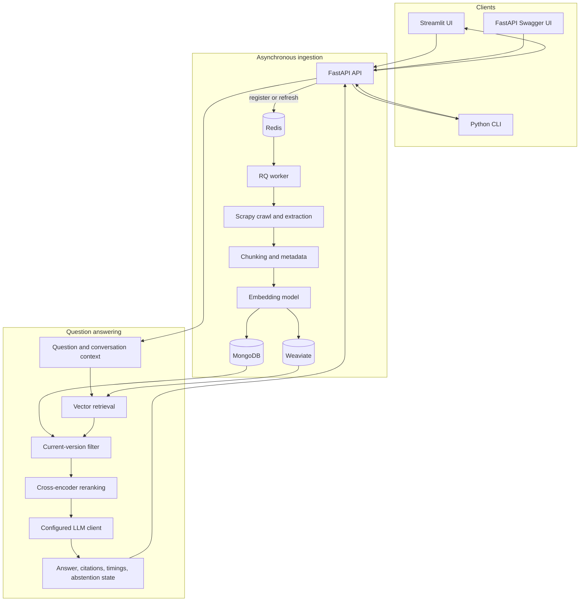

# DocuPilot Architecture and Design Decisions

This document describes the current implementation in this repository. It distinguishes implemented behavior from known gaps and future work; it is not a claim that the project is already hardened for production.

## 1. System overview

DocuPilot is a documentation-focused retrieval-augmented generation (RAG) application. It accepts documentation URLs, crawls and indexes their content asynchronously, retrieves relevant passages for user questions, and returns answers with page-level citation metadata. The answer path can abstain when evidence is insufficient.



## 2. Services and responsibilities

| Component | Responsibility | Current implementation |
|---|---|---|
| Streamlit UI | Source management and interactive question answering | Optional Compose profile `ui`, local port 8501 |
| CLI | Menu-driven access to source, job, and question endpoints | `python -m docupilot.cli` in the API container |
| FastAPI | HTTP API, validation, source/job management, question orchestration | `src/docupilot/main.py`, local port 8000 |
| Redis | Queue backend for background ingestion | Compose service `redis` |
| RQ worker | Executes ingestion jobs outside the request path | Compose service `worker` |
| Scrapy/extraction | Crawls reachable documentation pages and extracts content | Crawler modules under `src/docupilot/crawler/` |
| Chunking and embeddings | Prepares passages for semantic retrieval | Indexing modules under `src/docupilot/indexing/` |
| MongoDB | Source records, page metadata, crawl records, page versions, and conversation turns | Compose service `mongodb`, database defaults to `docupilot` |
| Weaviate | Stores vector representations used for retrieval | Compose service `weaviate` |
| Retrieval pipeline | Finds candidate evidence and filters outdated page versions | `src/docupilot/retrieval/` |
| Cross-encoder reranker | Reorders retrieved candidates before answer generation | Configured in the API's answer-service construction |
| LLM provider | Generates an answer from the retrieved evidence | Environment-configured client |

The default Compose stack starts the API, worker, Redis, MongoDB, and Weaviate. The Streamlit UI is opt-in with the `ui` profile.

## 3. Main data flows

### 3.1 Register and ingest a source

1. A client sends a documentation URL and crawl limits to `POST /sources`.
2. The API normalizes the URL and derives a stable source identifier.
3. Source metadata is created or updated in MongoDB.
4. The API reserves the source for ingestion and enqueues an RQ job in Redis. It returns a job ID and queued status rather than waiting for the crawl to finish.
5. The worker crawls reachable pages subject to the configured page and depth limits.
6. Extracted page content is normalized and chunked. The indexing path creates embeddings for retrieval.
7. Page/source/crawl/version metadata is stored in MongoDB and vector records are stored in Weaviate.
8. Clients poll `GET /jobs/{job_id}` and inspect `GET /sources/{source_id}` for status and crawl summaries.

A refresh uses `POST /sources/{source_id}/refresh` and queues another ingestion job. The API prevents a source from being queued again while its status indicates an active job.

### 3.2 Ask a question

1. A client sends a non-empty question to `POST /questions`, optionally including source IDs and a conversation ID.
2. The API loads recent conversation turns from MongoDB when a conversation ID is supplied and passes the history to the answer service.
3. The retrieval pipeline embeds the query and retrieves candidate passages from Weaviate.
4. A version filter uses MongoDB page metadata to avoid retrieving superseded page versions where applicable.
5. A cross-encoder reranks the candidates. The current API construction enables reranking, with a candidate limit of 20 and a final limit of 6.
6. The configured LLM client receives the question and selected evidence and generates a grounded response or an abstention.
7. The API returns the answer, citation metadata, retrieval/timing details, abstention state, and conversation ID. The latest conversation turns are persisted in MongoDB.

Citation entries currently contain metadata such as reference label, page URL, title, source ID, chunk ID/index, and content hash. They do not expose a full quoted evidence excerpt in the current API response.

## 4. HTTP API surface

The interactive API documentation at `http://localhost:8000/docs` is the authoritative schema for the running version.

| Endpoint | Purpose |
|---|---|
| `GET /health` | Basic API health response |
| `POST /sources` | Register a URL and enqueue initial ingestion |
| `GET /sources` | Paginated list of registered sources |
| `GET /sources/{source_id}` | Source metadata, indexed-page/version counts, and latest crawl summary |
| `POST /sources/{source_id}/refresh` | Queue a re-crawl of a registered source |
| `GET /jobs/{job_id}` | Inspect ingestion job status/result/error |
| `POST /questions` | Ask a question, optionally scoped to sources and a conversation |

The current source detail response does not include a complete list of indexed page URLs. Citation URLs are returned for pages used in an individual answer.

## 5. Data ownership and persistence

- **MongoDB** is the source of truth for source records and operational metadata, including crawl records, page records, page versions, and conversation turns.
- **Weaviate** holds vector records used to retrieve semantically relevant chunks.
- **Redis/RQ** carries ingestion jobs and their status/results.
- **The LLM provider** is called at answer time; generated answers and citation metadata are persisted as conversation turns by the API.

Docker Compose declares named volumes for MongoDB, Weaviate, and Redis so data survives container recreation. Removing volumes with `docker compose down -v` deletes persisted data and should be treated as a destructive reset.

## 6. Configuration and local deployment

### Environment variables

The checked-in `.env.example` currently defines:

| Variable | Purpose |
|---|---|
| `LLM_API_KEY` | Provider credential |
| `LLM_BASE_URL` | OpenAI-compatible API base URL |
| `LLM_MODEL` | Model identifier accepted by the configured provider |
| `LLM_TIMEOUT_SECONDS` | LLM request timeout |

The API also reads service connection settings such as `REDIS_URL`, `MONGODB_URI` / `MONGO_URI`, `MONGODB_DATABASE` / `MONGO_DATABASE`, and Weaviate host/port values, with defaults appropriate to the Compose network. Do not commit real credentials.

### Run the backend

```bash
cp .env.example .env
# Edit .env and set valid provider credentials/model configuration.
docker compose up --build -d
docker compose ps
curl http://localhost:8000/health
```

### Run the optional UI

```bash
docker compose --profile ui up --build -d ui
```

Open `http://localhost:8501`. The UI container uses `DOCUPILOT_API_URL=http://api:8000` to reach the API over the Compose network.

### CLI

```bash
docker compose exec api python -m docupilot.cli
```

### Diagnostics

```bash
docker compose logs -f api worker
docker compose logs -f ui
docker compose ps
```

## 7. Design decisions and trade-offs

### Asynchronous crawling

**Decision:** Source registration enqueues work through Redis/RQ instead of running the crawl synchronously inside the HTTP request.

**Reason:** Crawling can take much longer than a typical API request. A queue separates request latency from ingestion duration and makes job status inspectable.

**Trade-off:** The queue and worker add operational components. Job failures must be diagnosed through job status and worker logs; production deployments would need stronger retry/dead-letter and alerting policies.

### Separate metadata and vector storage

**Decision:** MongoDB stores structured source/page/crawl/version/conversation records, while Weaviate stores vectors for semantic retrieval.

**Reason:** Structured metadata and vector similarity have different access patterns. Keeping them separate makes version tracking and vector retrieval independently manageable.

**Trade-off:** The two stores must remain consistent. Recovery/re-indexing and consistency checks are important future improvements.

### Version-aware retrieval

**Decision:** A current-version filter consults MongoDB page metadata during retrieval.

**Reason:** Re-crawling a page can create a newer content version. Retrieval should avoid presenting obsolete content as if it were current.

**Trade-off:** Correctness depends on the ingestion pipeline recording version metadata reliably and the filter matching the stored schema.

### Cross-encoder reranking

**Decision:** Retrieve a candidate set, then rerank it with a cross-encoder before generation. The current API setup enables reranking and uses a candidate limit of 20 and final limit of 6.

**Reason:** Vector similarity is efficient for candidate generation; a cross-encoder can provide a more precise relevance ordering for the final evidence set.

**Trade-off:** Reranking increases compute and latency. The existing small evaluation has incomplete runs and cannot establish a universal quality improvement. Reranking should be assessed using a larger paired dataset and both quality and latency measures.

### Grounded answers, citations, and abstention

**Decision:** Return citation metadata for supporting pages and represent abstention explicitly when evidence is insufficient.

**Reason:** A technical documentation assistant should make it possible to inspect original sources and avoid presenting unsupported answers as verified.

**Trade-off:** Citations help users verify claims but do not guarantee that every claim is supported. Citation correctness and answer faithfulness still need systematic evaluation. The current API does not return full evidence excerpts.

### Existing pretrained models and an external LLM

**Decision:** Use existing embedding/reranking components and a configured LLM provider instead of training a large model for this project.

**Reason:** The project focuses on retrieval quality, application architecture, reproducibility, and deployment rather than expensive model training.

**Trade-off:** Runtime requirements, quality, quotas, availability, and latency depend on the chosen models and provider.

### Optional UI profile

**Decision:** Keep the Streamlit UI in a separate Compose profile.

**Reason:** The API/worker stack can be started and tested without building or running the UI image.

**Trade-off:** Users who want the browser interface must explicitly start the `ui` profile.

## 8. Evaluation approach

Evaluation should separate retrieval relevance from generated-answer quality and system cost.

Recommended dimensions:

- **Retrieval:** label relevant chunks and measure metrics such as MRR, nDCG@k, and context precision/recall.
- **Grounding:** review faithfulness, citation correctness, and whether the evidence actually supports each answer claim.
- **Abstention:** test questions that cannot be answered from the indexed sources.
- **Latency:** measure retrieval, reranking, generation, and end-to-end time across repeated runs.
- **Reliability:** track failures separately by cause, including provider quota/rate limits, timeouts, ingestion errors, and malformed extraction.

The current five-question reranking comparison is exploratory and has incomplete paired answers due to LLM provider quota/rate-limit failures. Successful individual examples are useful for debugging, but do not establish an overall improvement. Keep the dataset, configuration, model identifier, and commit fixed for paired comparisons.

## 9. Known gaps and next steps

- Add an endpoint and UI table that lists all indexed page URLs for a source.
- Return optional evidence excerpts alongside citation metadata so users can inspect the exact supporting passage.
- Expand and version the evaluation dataset; add chunk relevance labels and repeatable quality/latency reports.
- Evaluate reranking settings, candidate count, and final context size against measured trade-offs.
- Improve retry policy, job recovery, ingestion observability, and extraction coverage for dynamic sites.
- Add authentication, authorization, per-user/tenant isolation, rate limiting, and production deployment controls before public multi-user deployment.
- Add CI and integration tests that exercise ingestion, retrieval, and question answering across the Compose services.

## 10. Contribution notes

For the standard setup, testing commands, demo asset filenames, limitations, and contribution workflow, see the [main README](../README.md). When changing a service contract or a design decision, update this document and add tests or reproducible evidence where practical.
